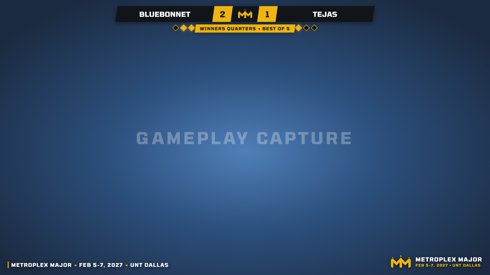
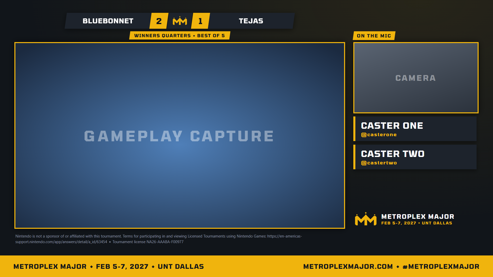
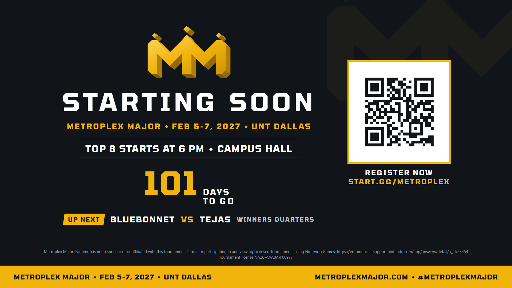
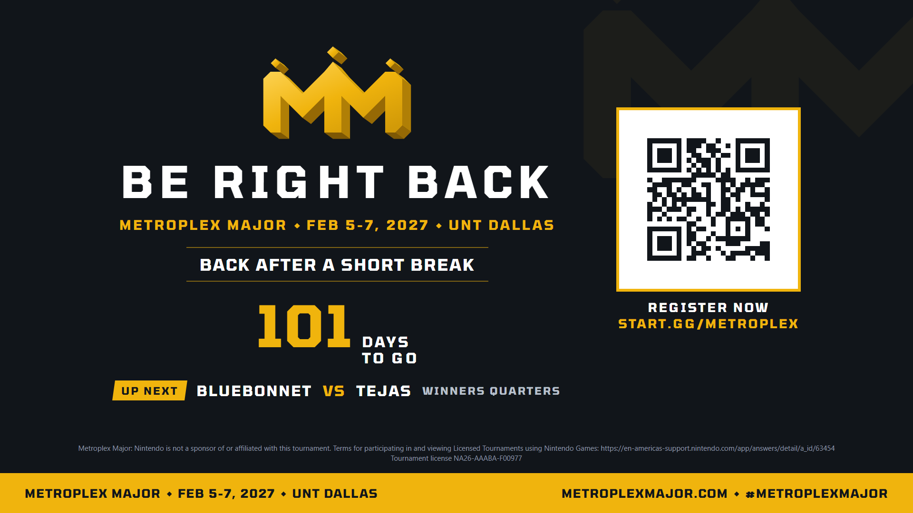
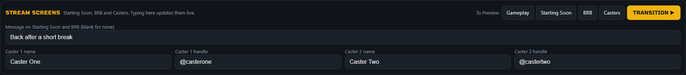

# TEC Match Recorder

A one-button recording station for fighting game tournaments (Super Smash Bros. Ultimate, Tekken 8, Street Fighter 6),
built by Texas Esports Collective for its own events and released under the MIT license for any TO to use. It sits next to OBS or vMix on the capture PC: the operator picks the set being played (live from the
start.gg bracket) or types the players, hits **Start**, and when the set ends hits **End & Save**. The app stops the
recording, renames the file to a proper VOD title, logs it, and is ready for the next set.

```
2026-10-06 C - San Japan 2026 Winners Quarters - Liva (Pikachu) Vs. Leffen (Fox) Smash Ultimate - SSBU.mp4
```

Internet is used when available (live bracket updates from start.gg) and never required: with no connection, the
last-synced bracket and manual entry keep working, and sync resumes on its own.

## Screenshots

Captured from the recorder itself in the Metroplex Major theme, with made-up player and caster names. The labeled
blue and grey areas are where OBS shows the gameplay capture and the camera.

**Stream overlay** over the gameplay: names, score, round, games won, and the rotating promo line and crown in the
corners.



**Casters** scene: gameplay and camera windows, the set and score above, one or two name cards.



**Starting Soon** and **BRB**: the up-next set, a message typed in the dashboard, the countdown and register link.





The dashboard's **Stream screens** panel, where the message and the caster cards are typed:



## Requirements

- Windows PC with the capture card (any Windows 10/11 machine works).
- **OBS Studio 28 or newer** (the WebSocket server is built in; tested with OBS 32), **or vMix** with its Web
  Controller turned on (see [Using vMix instead of OBS](#using-vmix-instead-of-obs)).
- **Node.js 22 or newer** (LTS download from https://nodejs.org). No other installs, no `npm install`.

Get the code by downloading the repository as a zip or with `git clone`, then run `Start Recorder.bat` (or `node server.js`).
Settings in the dashboard writes `data/config.json` on first save; `data/config.example.json` shows the shape if you
prefer to create it by hand. Nothing else needs to exist before the first start.

On the first start a **setup checklist** opens: OBS (or vMix) connection, recording folder, start.gg bracket, character art and a
test recording, each with a green, yellow or grey mark. None of it is mandatory; tick *Don't open this at startup*
and it lives on under Settings, About and maintenance.

## First-time setup (5 minutes)

1. **OBS: Tools, then WebSocket Server Settings.** Tick *Enable WebSocket server*, keep port 4455, click
   *Show Connect Info* and copy the password.
2. **OBS recording settings** (Settings, Output, Recording):
   - Recording format **MKV** or **Hybrid MP4**. Both survive a crash or power blip; avoid plain MP4.
     OBS's "Automatically remux to mp4" option is fine either way, the app waits for the remux to finish.
   - 1080p60 output, hardware encoder (NVENC, AMD AMF or QuickSync) if the PC has one.
     15 Mbps is about 7 GB per hour, so a full day of locals fits comfortably under 100 GB.
   - Recording path: any folder on a drive with space (the app reads this from OBS automatically).
   - If the same OBS also streams (VGBootCamp caps streams at 6000 kbps), keep the recording on its own
     higher-quality encoder. The recorder never touches the stream output.
3. Double-click **`Start Recorder.bat`**. A console window stays open (leave it) and the dashboard opens at
   http://localhost:8420. Windows Firewall may ask about Node.js: allow it if you want to control the recorder
   from a phone or tablet on the same Wi-Fi; otherwise it doesn't matter.
4. In the dashboard click **Settings**:
   - **OBS WebSocket**: paste the password. The OBS chip in the header turns green.
   - **start.gg live sync** (optional): paste the event URL (the page that shows the bracket, e.g.
     `https://www.start.gg/tournament/san-japan-2026/event/ultimate-singles`) and an API token.
     Get a token at start.gg: click your profile, then **Developer Settings**, then *Create new token*.
     The bracket appears within seconds and refreshes itself every 45 s while online.
   - **Event**: titles use the start.gg tournament name unless you type one here.

Settings live in `data/config.json` on this PC only. The token never leaves the machine.

## Using vMix instead of OBS

1. **vMix: Settings, Web Controller.** Tick *Enable* and keep port 8088. A user name and password are optional.
2. **vMix: Settings, Recording.** Pick the folder and format there. The recorder starts and stops vMix's own
   recording, so whatever vMix records is what gets renamed.
3. **Recorder: Settings, Production software: vMix**, then Save. Leave the host at `127.0.0.1` when vMix runs on the
   same PC. The header chip reads **vMix connected**.
4. Run **Test recording** (setup checklist or Settings, About and maintenance) once. vMix reports the file it writes,
   and that tells the recorder which folder to watch for disk space.

Everything else works the same: pick the set, Start, End & Save. Stopping the recording from inside vMix is
noticed and the file is still labelled. Differences from OBS:

- **Overlay**: **Add overlay to vMix** adds a Browser input called "TEC Overlay" and puts it on the first free overlay
  channel (or the one picked in Settings), so the names sit over whatever is in Program. If your project is not
  1920x1080, set the Browser input to 1920x1080 in its own settings.
- **Character detection** reads vMix snapshots, which vMix saves as files, so it needs vMix on the same PC as the
  recorder. Pick the gameplay input under Settings, Character detection, or leave it on Program output.
- **Training scans** play old recordings through OBS, so they stay OBS-only. Reviewing frames works with vMix.
- vMix versions that do not report the recording's file name still work: the recorder takes the newest video in the
  recording folder (learnt from the first recording, or typed into Settings, vMix).

## Event day

The big **How to run the station** button under Start Recording opens the same guide on screen. See
[OPERATOR-CHEATSHEET.md](OPERATOR-CHEATSHEET.md) for the printable one-page version. In short:

1. Tap the set in the bracket list (or type both names). Add characters with **Characters…** if you know them.
2. **START RECORDING** as soon as the players sit down. Names and characters can still be edited while recording.
   Players sat on the wrong sides? Hit the **⇄ swap** button between the two names instead of making them move.
3. When the set is over: **END & SAVE**, then tap it again to confirm. The file is renamed a few seconds later,
   the log at the bottom shows it, and **Copy row** puts a Stream-Bible-ready line on the clipboard.
4. The form clears itself. Next set.

If someone stops the recording from inside OBS, the app notices and labels that file too. If the dashboard tab is
closed or refreshed mid-set, nothing is lost: the recording state lives in the app, not the browser.

## What gets written

Inside OBS's recording folder, in a subfolder named after the event (toggle in Settings, Naming):

- The renamed recordings.
- `recordings.csv`, one row per set: Player 1, Character(s), Player 2, Character(s), Round, Set, Date, Time,
  Duration, Title, Filename, Event. The first five columns match VGBootCamp's Stream Worksheet, so a whole day
  can be pasted in at once (**Copy all worksheet rows** in the dashboard does the same via the clipboard).

## Naming

Default title template (Settings, Naming), which mirrors the VGBootCamp VOD title formula:

```
{event} {round} - {p1} ({chars1}) Vs. {p2} ({chars2}) {suffix}
```

Fields: `{event} {round} {set} {p1} {p2} {chars1} {chars2} {suffix} {date} {time}`. Empty parentheses and dangling
dashes are removed automatically, so a set without characters still produces a clean title. Filenames are the
title with Windows-illegal characters stripped, prefixed by `{date} {set}` so they sort in bracket order (toggle).
Sponsor prefixes (`TSM | Leffen`) are stripped from start.gg names by default; multiple characters per player are
comma-separated (`Joker, Peach`); start.gg round names are normalized (`Winners Quarter-Final` becomes
`Winners Quarters`, pool sets become `Pools`) and can always be edited before saving.

## Several games and several brackets

The recorder knows three games: Super Smash Bros. Ultimate, Street Fighter 6 and Tekken 8 (plus a generic
"other"). Each start.gg event carries its game, so picking a set from a Tekken bracket switches the title suffix
to "Tekken 8 - T8", hides the character chips and pauses the detector; picking an Ultimate set switches them back.
For manual entry, the game dropdown above the player names does the same. The CSV gains a Game column.

Settings takes several event URLs (one per line), or paste a tournament URL into **Add a whole tournament** and
the recorder adds every Ultimate singles, Street Fighter 6 and Tekken 8 bracket it finds, skipping doubles, crews,
squad strike and games it does not know. With more than one bracket loaded, the bracket list gets event tabs; in
pools it also gets pool chips, groups sets by pool, and names files with the pool ("A3-A").

Two brackets of the same game on one night (Tuesday Takedown's Ultimate Singles plus its Redemption bracket) would
give identical titles, so sets from the smaller bracket carry its event name in the round: "Redemption Winners
Round 1". The bracket cards show which event each set belongs to.

A station that only ever records Ultimate can tick **Smash Ultimate only** (Settings, Look and games). The game
picker, the SF6/Tekken title suffixes and their brackets disappear; tournament import skips them too.

## Stream overlay (player names over the gameplay)

Settings has a **Stream overlay** section. **Add overlay to OBS** puts a Browser Source called "TEC Overlay"
(1920x1080, transparent) at the top of the chosen scene, normally *Gameplay*. It draws two name plates and a
centre plate in the style of the TEC FGC overlay, filled from the current set: Player 1 on the left, Player 2 on
the right, and the round (or set id, game or tournament name, your choice) in the middle. Names update the moment
you pick another set or swap sides, and long tags shrink to fit instead of being cut off. Each player has a **Wins**
counter under their name (+1 / -1); the wins show as a white badge on each plate (toggle in Settings) or, if you
prefer, as "2 - 1" in the centre plate. Wins reset with the next set, swap with the players, and go into the CSV
(Score column) and the `{score}` title field. For Ultimate (HUD at the bottom) it is one bar across the top. For Tekken 8 and Street Fighter 6, whose health
bars, timer and round-win markers live at the top, it becomes a notched shape: two deep name plates above the
health bars joined by a thin bridge over the top-centre, so the timer and round markers stay uncovered. Preview it at
http://localhost:8420/overlay. **Remove from OBS** takes the layer out again.

After you press the button, the header chip reads **Overlay: live in <scene>**, the layer shows sample names for
30 seconds, and if OBS is showing a different scene the message says so: switch OBS to that scene to see it. The item
is scaled to your canvas, so a 1280x720 canvas gets the same layout at 2/3 size.

## Character detection (optional)

The recorder can recognize the fighters during a game and fill them in for you. While OBS is connected it looks
at the program output about once a second and matches each player's HUD portrait (the character picture next to
the damage number) against a reference pack of every fighter and costume. A read only counts when the panel's
damage "%" is visible and three consecutive frames agree, so cinematics, menus and the results screen don't
fool it. Detected characters appear as chips marked "auto" and can be removed like any other; the costume number
is written to `recordings.csv`. It also reads the names off the VS splash screen shown before each game, using
name templates it learns from you.

One-time setup: in Settings, under **Character art**, press **Download portrait pack** (693 files, about 23 MB, from the
public TournamentStreamHelper assets repository, into `data/portraits/`); `node tools/fetch-icons.js portrait` does the same
from a console. The portraits are Nintendo's artwork, so they are not part of the download and stay on your PC only.
Without them, only learned portraits and VS
names are used.

It learns from you. Open **Train detector** (top right), pick an old recording and click **Scan**. OBS plays the
file in a temporary scene (never while recording or streaming), split into parallel lanes at 2x speed (4 lanes
scan an hour of footage in about 8 minutes; lower the lane count on a weak PC), and every game or VS screen it finds
lands in the review queue with its best guess. Confirm or fix the names; each confirmation adds a template. A live detection it isn't
sure about goes to the same queue, so a quick review after each event keeps it sharp. Settings has the on/off
switch, the OBS source to watch, and the recordings folder for scans.

Testing without hardware: add a **Browser Source** in OBS pointing at
`http://localhost:8420/standin.html?v=<YouTube video id>&t=<start seconds>` (1920x1080) and put that scene on the
program output; the detector treats it like a capture feed. Raw game-feed uploads work best; broadcast VODs with
overlays or player cameras can cover the HUD panels the detector reads.

Storage: `data/templates/` holds the learned name masks (plus a crop of each so you can see what was learned) and
`data/samples/` holds frames waiting for review, which are deleted once reviewed.

## After the event: title cards and the YouTube package

- `node tools/thumbnails.js "<event name>"` renders one 1280x720 title card per recording into
  `<recordings>\<event>\_upload\thumbnails\` (needs Chrome installed). Cards use the fighter portraits from
  `data/portraits` (the costume that was recorded, when known) and an optional event logo at
  `data/event-logos/<event-slug>.png` or `.jpg`; games without character art get the player names large.
- `GET /api/upload-package?event=<event name>` returns the package as JSON (title, description text and a card URL
  per video) for scripts or a helper page. It reads `upload-manifest.csv`, `descriptions\` and `thumbnails\`
  from that event's `_upload` folder.
- YouTube strips punctuation from file names, so set each title in Studio from the manifest rather than trusting
  the upload name. Upload as Unlisted first, then flip to Public once the playlist is in order.

## Running it on another PC, or from a phone

- Copy the whole folder to the rig, install Node.js there, run `Start Recorder.bat`. Done.
- Out of the box the dashboard answers only on the recording PC (`localhost`). To run the station from a phone,
  tablet or second laptop, open Settings, **Network access**, and tick *Let other devices on this network open the
  dashboard*. A PIN is required for those devices; leave the field blank and one is made for you and shown right
  there. The console then also prints an address like `http://192.168.1.23:8420` to open on the other device, which
  asks for the PIN once and remembers it. No internet is needed, just the local network.
- OBS on a different PC than the recorder? Add `?pin=YOURPIN` to the overlay Browser Source URL.

## Stream screens and scene switching

Three full-screen 1920x1080 scenes in the Metroplex Major look:

- **Starting Soon** (`/slate?scene=starting`) and **BRB** (`/slate?scene=brb`): the set picked on the station ("Up
  next", or "On now" while recording), a message typed in the dashboard, and in promo mode the countdown and the
  register QR. The Nintendo notice and license number sit at the bottom.
- **Casters** (`/casters`): the gameplay capture in a large window, one camera in a smaller one with "On the mic"
  above it, one or two caster name cards (name plus an optional handle) under the camera, and the set and score
  above the gameplay.

The **Stream screens** panel under the current set holds the message and the two caster cards; what is typed there
shows on the screens straight away. A card with no name is not drawn. When the production software is connected,
the panel also has a button per scene (Gameplay, Starting Soon, BRB, Casters).

**Preview or Program** (Settings, *Scene changes from the recorder go to*): by default every scene change from the
recorder lands in **Preview** (OBS Studio Mode, vMix Preview) and nothing goes live until you take it with the
transition, from OBS or vMix as usual or with the panel's **Transition ▶** button. Pick *Program* to have the
buttons and the automatic switching cut straight away instead. With Studio Mode off, OBS has no Preview, so Preview
mode reports that rather than cutting live.

**Setup:** Settings, *Stream screens and scene switching*, **Add Metroplex Major scenes**.

- **OBS**: creates the scenes "MM Starting Soon", "MM BRB" and "MM Casters". Casters gets the gameplay capture (the
  detector's source if it is a video input, else the bottom-most video source of the gameplay scene) placed in the
  big window, and, if OBS has a second camera-type input (one named like "cam", "caster" or "face" first), that
  camera in the small one. Otherwise drag the camera into MM Casters and fit it to the small window: 480x270 at
  1380, 168 on a 1920x1080 canvas. Pressing the button again refreshes everything without duplicating it.
- **vMix**: adds "MM Starting Soon", "MM BRB" and "MM Casters" as Browser inputs. For Casters, open the input's
  settings, **Layers**, and add the gameplay input (position 60, 168, size 1280x720) and the camera (1380, 168,
  480x270) as layers underneath the frame. This part is not automated for vMix.

**Switch scenes for me** (off by default): Start Recording sends the gameplay scene, End & Save stops the recording
first and then sends the between-sets scene (MM BRB unless another is picked). In Preview mode they wait in Preview
for your transition; a recording starts on whatever is live, so take Gameplay live before Start Recording to keep
the between-sets screen out of the VOD. In Program mode Start Recording cuts to gameplay, waits for the transition,
then records. A set stopped from inside OBS or vMix is left alone, and a failed switch is logged without stopping
the recording.

## Branding and themes

TEC colors (Ignite Red `#FF3D2E`, Scholastic Green `#1FC97B`) and the Urban Constructed display font, on the
dashboard and the stream overlay in every theme. The fonts are bundled in `public/fonts/` so the dashboard looks right
offline and on any machine. Urban Constructed is free for noncommercial use only (Creative Commons BY-NC, see
`THIRD_PARTY.md`); Tomorrow, Oswald and Silkscreen (SIL Open Font License) are the fallbacks.

Settings, **Look and games**, switches the whole station to another event series' look. The one built in besides
TEC is **Tuesday Takedown** (TAMUSA Esports' Smash monthly):

- Dashboard in TAMUSA maroon and championship-belt gold, with Urban Constructed display type.
- Stream overlay rebuilt from the TT stream's scoreboard: maroon name plates in a black frame with the win count at
  each end, the belt logo over the middle, the round and "Best of 3" in black bands underneath, game-win pips
  beside them, and "Tuesday Takedown" in yellow on the left (the label is editable, blank hides it). Tags use
  Urban Constructed in mixed case, whose small-capital lowercase keeps the stream's small-caps look. Tekken 8 and
  SF6 keep their notched shape in TT colors.
- The TT logo is event artwork, so it is not in this repository. **Use the start.gg tournament logo** saves the
  tournament's profile picture from start.gg (it happens on its own the first time the theme is picked with a
  bracket loaded), or **Choose image…** takes any PNG, JPG or WebP. It is kept in `data/branding/` on that PC.
  Without one, a plain TT badge stands in.
- Picking the theme also ticks Smash Ultimate only, which can be unticked.

The other is **Metroplex Major**, TEC's flagship weekend (Feb 5-7, 2027, UNT Dallas), used to promote it at every
event TEC runs beforehand and then on the weekend itself. It is the default theme for new installs until the weekend
is over (TEC after Feb 7, 2027); a station that has saved a theme keeps it.

- Dashboard in Major Gold on Midnight with Tomorrow display type, the crown in the header and, in promo mode, a
  countdown under it ("108 days out").
- Stream overlay from the MM stream kit: midnight name plates, gold score cells, the crown in the middle, the round
  and set length on a gold band underneath, and a gold gem per game won under each name. Tekken 8 and SF6 keep
  their notched shape in MM colors.
- Bottom corners: a ticker that fades through one line every 7 seconds (bottom-left) and the crown lockup
  (bottom-right). Off for Street Fighter 6, whose meters sit there, and switchable for the rest.
- **Mode**: *Promo* for the weeks before (countdown, register link, bonuses, dates) or *Event* for the weekend
  (site, venue). Each mode has default ticker lines; type your own in Settings to replace them. `◆` (or `<>`)
  draws the gold gem, `{days}` is the countdown and drops off once the weekend starts, `{event}` is the tournament
  loaded from start.gg.
- **Slate**: http://localhost:8420/slate is a full-screen 1920x1080 MM screen for between sets, breaks and venue
  TVs. Promo mode shows the countdown and the register QR; both modes show the set on the station ("Up next",
  or "On now" while recording) and print the Nintendo notice and the license number. `?title=Starting%20Soon`
  changes the headline.
- The crown is TEC's own mark and ships with the app, so this theme needs no logo upload.

Overlay geometry can be fine-tuned in `data/config.json` under `overlay.tt` or `overlay.mm` (for example
`"logo": 190` or `"nameW": 420`; the defaults are at the top of `public/overlay.js`).

## License

MIT, see `LICENSE`. Third-party material (the fonts, the character art source, OBS and start.gg) is listed in
`THIRD_PARTY.md`. "Smash", "Tekken" and "Street Fighter" are their owners' trademarks; this project is not affiliated
with Nintendo, Bandai Namco, Capcom, OBS or start.gg.

## Maintenance (Settings, About and maintenance)

- **Test recording**: records five seconds in OBS, checks that a file appeared in the recording folder, then deletes
  it. Run it once the capture chain is plugged in, before the first bracket.
- **Check for updates**: compares this version with the latest GitHub release. When a newer one exists, **Update
  now** downloads it, checks it against the SHA-256 GitHub publishes for the file, and copies it over the app
  folder. The recorder then restarts by itself in the same black window and the dashboard reloads on the new
  version (about 10 seconds). It never touches `data/` (settings, session log, learned templates, logos) or
  `node.exe`, keeps a copy of every file it replaced in `data/update/backup-v<old version>`, and puts the old
  files back if anything fails while copying. It waits while a set is recording or saving. Nothing installs
  without the button being pressed. A git clone updates with `git pull` instead. Versions before 1.2.0 do not
  have the button: replace their folder with the new release zip once (keep the old `data` folder).
- **Download diagnostics** saves a JSON file (versions, OBS or vMix state, recent log lines, config without
  secrets) to attach to a bug report.
- **Detector sample frames**: the character detector keeps small review frames in `data/samples`. They are capped at
  500 MB by default (oldest go first, frames still waiting for review are kept); set the cap to 0 for no limit, or
  press *Clear samples now*.

## Troubleshooting

| Symptom | Fix |
| --- | --- |
| Header says **OBS not connected** | OBS isn't running, or Tools, WebSocket Server Settings isn't enabled. The app reconnects by itself every 3 s. |
| **OBS: wrong password** | Re-copy the password from OBS (Show Connect Info) into Settings. |
| Header says **vMix not connected** | vMix isn't running, or Settings, Web Controller isn't enabled in vMix. Check the host and port under Settings, vMix. |
| **vMix did not start recording** | vMix refused: check its Settings, Recording (the folder must exist). |
| **vMix did not report where it saved** | Older vMix. Type its recording folder into Settings, vMix, then press **Retry** on the log row. |
| Log row shows **error** | Click **Retry**. Common cause: OBS was still finalizing the file. The original is untouched in the OBS folder. |
| **start.gg error: rejected the API token** | Create a fresh token in start.gg Developer Settings and paste it into Settings. |
| **start.gg OFFLINE** | No internet. The cached bracket and manual entry keep working; sync resumes automatically. |
| "Port 8420 is already in use" | The recorder is already running (check the taskbar), or change `port` in `data/config.json`. |
| Wrong names saved | Fix the file name in Explorer (Open recordings folder) and the row in `recordings.csv`. |
| Start over | Close the app and delete `data/state.json` (log and recent players) or `data/config.json` (settings). |

Run `node server.js --no-browser` to start without opening a browser tab.
